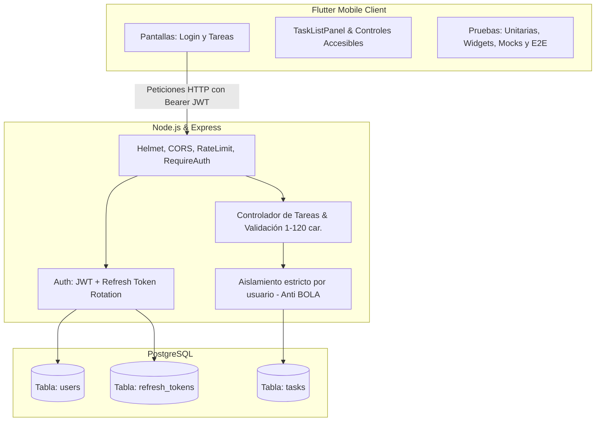

# Task Manager: Guía Práctica de Pruebas de Software (QA & Testing)


Proyecto integral de desarrollo y aseguramiento de calidad (QA) basado en la guía **"Become a Better Application Tester: A Hands-On Task Manager Guide"**, desarrollado para la materia de **Desarrollo Móvil Integral** (10° Cuatrimestre).

Integra una aplicación móvil en **Flutter**, una API REST en **Node.js/Express** con persistencia en **PostgreSQL**, autenticación **JWT con rotación de Refresh Tokens**, y una suite de pruebas automatizadas con más de 39 pruebas cubriendo toda la pirámide de pruebas.

---

## Arquitectura del Sistema



---

## Evidencias de la Aplicación en Ejecución


### 1. Inicio de la API REST (Backend)
Servidor Node.js/Express escuchando en el puerto local con comprobación de salud activa (`/health`).


---

### 2. Inicio de Sesión en la App Móvil (Flutter)
Pantalla de autenticación con campos accesibles para correo y contraseña, control de estados de carga y validación de credenciales.


---

### 3. Pantalla Principal y Listado de Tareas
Visualización de tareas sincronizadas para el usuario autenticado con soporte para estado vacío y prevención de acceso cruzado entre cuentas.


---

### 4. Diálogo de Creación de Tareas
Formulario modal responsivo con validación en tiempo real (longitud entre 1 y 120 caracteres, rechazo de cadenas vacías o espacios).


---

### 5. Finalización de Tareas (Completada)
Marcado de tareas con checkbox accesible, texto tachado (`lineThrough`) y persistencia en base de datos.


---

## Evidencias de Ejecución de Pruebas

### 1. Pruebas Automatizadas del Backend (Jest + Supertest)
Ejecución de las 24 pruebas que validan lógica unitaria de títulos, endpoints protegidos, rotación de tokens JWT, prevención de inyección SQL, XSS y límites de propiedad (BOLA / Mass Assignment).


---

### 2. Pruebas Automatizadas de Flutter (`flutter test`)
Ejecución de las 15 pruebas unitarias del modelo `Task`, pruebas de widgets con el botón de reintento (`TaskListPanel`) y pruebas con cliente simulado (`MockClient`).


---

### 3. Prueba End-to-End de Viaje del Usuario (`integration_test`)
Prueba completa simulando la navegación real del usuario: Login $\to$ Crear tarea $\to$ Marcar completa $\to$ Cerrar sesión $\to$ Regreso al login.


---

### 4. Prueba de Carga y Rendimiento con k6
Ejecución de 5 usuarios virtuales concurrentes durante 30 segundos evaluando el cumplimiento del percentil 95 ($p95 < 500\text{ ms}$).


---

## Resumen de Ejercicios y Documentación (Secciones 1 a 15)

Todos los ejercicios prácticos solicitados en la guía han sido resueltos y documentados en la carpeta [`docs/`](docs/):

| Sección | Tema | Ejercicio Práctico Solicitado | Documento / Código |
| :---: | :--- | :--- | :--- |
| **1** | Mentalidad del Tester | 3 Criterios de Aceptación (éxito, entrada inválida, permisos) | [`docs/01_PLAN_DE_PRUEBAS.md`](docs/01_PLAN_DE_PRUEBAS.md) |
| **2** | Casos de Prueba y Bugs | Reporte de defecto formal: Tarea desaparece al completarse | [`docs/02_CASOS_DE_PRUEBA_Y_REPORTE_DE_BUGS.md`](docs/02_CASOS_DE_PRUEBA_Y_REPORTE_DE_BUGS.md) |
| **3** | Pruebas Exploratorias | Sesión de 15 min: títulos largos, clics rápidos y pérdida de red | [`docs/03_NOTAS_SESION_EXPLORATORIA.md`](docs/03_NOTAS_SESION_EXPLORATORIA.md) |
| **4** | Pruebas Unitarias | Tests para ID faltante y longitud máxima exacta (120 caracteres) | [`backend/tests/unit/validation.test.js`](backend/tests/unit/validation.test.js)<br>[`mobile/test/unit/task_test.dart`](mobile/test/unit/task_test.dart) |
| **5** | Pruebas de Widgets | Botón de reintento en error y verificación de tap único | [`mobile/lib/task_list_panel.dart`](mobile/lib/task_list_panel.dart)<br>[`mobile/test/widget/task_list_panel_test.dart`](mobile/test/widget/task_list_panel_test.dart) |
| **6** | Pruebas de API | ID inválido, título ausente y bloqueo de edición de tareas ajenas | [`backend/tests/integration/tasks.api.test.js`](backend/tests/integration/tasks.api.test.js) |
| **7** | Viaje del Usuario (E2E) | Flujo completo: Login $\to$ Crear $\to$ Completar $\to$ Logout | [`mobile/integration_test/app_test.dart`](mobile/integration_test/app_test.dart) |
| **8** | Valores Límite | Partición y límites aplicados al campo de contraseña ($0, 7, 8, 128, 129$) | [`docs/08_VALORES_LIMITE_Y_PARTICION_EQUIVALENCIA.md`](docs/08_VALORES_LIMITE_Y_PARTICION_EQUIVALENCIA.md) |
| **9** | Seguridad OWASP | Intento de inyección de `ownerId`, SQLi y XSS en backend | [`backend/tests/integration/tasks.api.test.js`](backend/tests/integration/tasks.api.test.js)<br>[`docs/09_SEGURIDAD_OWASP_API.md`](docs/09_SEGURIDAD_OWASP_API.md) |
| **10** | Rendimiento (k6) | Ejecución de health check y análisis de cambio de umbrales | [`backend/k6/health-test.js`](backend/k6/health-test.js)<br>[`docs/10_RENDIMIENTO_K6_REPORTE.md`](docs/10_RENDIMIENTO_K6_REPORTE.md) |
| **11** | Accesibilidad | Auditoría con TalkBack, objetivos táctiles $\ge 48\text{dp}$ y fuente grande | [`docs/11_ACCESIBILIDAD_AUDITORIA.md`](docs/11_ACCESIBILIDAD_AUDITORIA.md) |
| **12** | Compatibilidad | Matriz de dispositivos y pantallas compactas vs grandes | [`docs/12_MATRIZ_COMPATIBILIDAD.md`](docs/12_MATRIZ_COMPATIBILIDAD.md) |
| **13** | Pruebas de Humo | Checklist de regresión (creación, edición, borrado, BOLA) | [`docs/13_CHECKLIST_REGRESION_Y_HUMO.md`](docs/13_CHECKLIST_REGRESION_Y_HUMO.md) |
| **14** | CI/CD | Pipeline de GitHub Actions y prueba de fallo intencional | [`.github/workflows/tests.yml`](.github/workflows/tests.yml)<br>[`docs/14_AUTOMATIZACION_CI_GITHUB_ACTIONS.md`](docs/14_AUTOMATIZACION_CI_GITHUB_ACTIONS.md) |
| **15** | Mocks vs Integración | Comparativa entre `MockClient` y pruebas con base de datos | [`mobile/test/unit/mock_api_client_test.dart`](mobile/test/unit/mock_api_client_test.dart)<br>[`docs/15_ANALISIS_MOCKS_VS_INTEGRACION.md`](docs/15_ANALISIS_MOCKS_VS_INTEGRACION.md) |
| **Extra** | Plan de Práctica | Cronograma estructurado de 4 semanas de pruebas | [`docs/PLAN_DE_4_SEMANAS.md`](docs/PLAN_DE_4_SEMANAS.md) |

---

## Guía de Instalación y Ejecución

### Prerrequisitos
- Node.js v20.x o superior
- Flutter SDK 3.16.x o superior con Dart 3.2+
- Git

### 1. Clonar el repositorio
```bash
git clone <URL_DE_TU_REPOSITORIO>
cd task_manager_testing
```

### 2. Configurar y Ejecutar el Backend
```powershell
cd backend
npm install

# Correr las 24 pruebas de la API (Unitarias + Integración)
npm test

# Iniciar la API REST
npm start
# La API se iniciará en http://localhost:3000
```

### 3. Configurar y Ejecutar la App Móvil
```powershell
cd ../mobile
flutter pub get

# Correr las 15 pruebas de Flutter (Unitarias + Widgets + Mocks)
flutter test

# Correr la prueba End-to-End
flutter test integration_test/app_test.dart

# Iniciar la aplicación en el emulador o navegador
flutter run
```

---

## Autor y Asignatura

- **Asignatura:** Desarrollo Móvil Integral
- **Nivel:** 10° Cuatrimestre
- **Proyecto:** Task Manager - Hands-On Application Tester Guide
